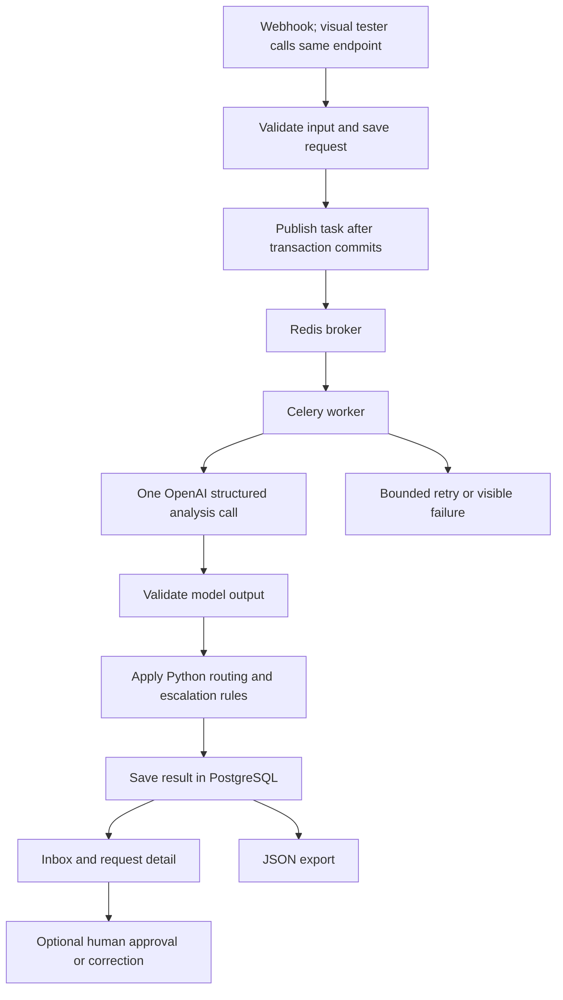

# ArcVault AI intake and triage assessment plan

This plan describes the proposed Aspire Software assessment submission: a Dockerized Django application that accepts customer requests, uses one OpenAI model call to classify and enrich each request, applies explicit routing and escalation policies, and presents the results for human review.

The objective is a complete, reproducible submission that demonstrates engineering judgment, measurable AI quality, and clear communication. This is the internal implementation plan, not the one-to-two-page architecture document for the recruiter. Implementation, model evaluation, deployment, and submission have not yet been completed.

**Recommended submission:** one reliable workflow, two polished screens, five real output records, a small honest evaluation, and a short recording. Keep Django, OpenAI, Celery, Redis, PostgreSQL, and Docker as agreed. Finish a submission-ready version before adding experiments or production features.

## Decisions locked on November 7, 2026

Implementation contracts are now specified in [docs/CONTRACTS.md](docs/CONTRACTS.md), with the model-owned schema in [contracts/analysis.schema.json](contracts/analysis.schema.json) and 25 controlled policy cases in [tests/fixtures/policy_cases.json](tests/fixtures/policy_cases.json). These define the v1 interfaces and acceptance expectations; they are not evidence of an implemented or validated application. The contracts resolve earlier optional-webhook wording and semantic-signal ambiguity.

- Use the latest stable Django: the official download page currently lists 6.1.3. Verify compatible Python and package versions and pin them during setup.
- Retain the remaining proposed stack and supporting packages below.
- Webhook-first ingestion; a visual tester page calls the actual endpoint and shows processing/results. Inbox/detail, review queue, and JSON export remain planned. Interactive correction remains planned polish, not a newly confirmed prerequisite.
- Use 50 reviewed cases: 5 assessment, 25 development, 10 validation, 10 locked final-test. Related variants stay within one split.
- One model call per attempt, independently scored for classification, extraction, urgency signals, and summaries. Test deterministic policy separately with controlled inputs, then test the integrated workflow.
- Optimize versioned prompts and schemas; model-weight fine-tuning is out of scope.
- Working deadline: November 8, 2026. Authorized total API ceiling: $83 before credits.

## 1. Context and constraints

- The recruitment email was received on November 4, 2026, at 11:42 AM, as reported by the candidate.
- The email requests submission within two days; the attachment says two business days. November 6 is the working original deadline, with the exact cutoff unconfirmed.
- The candidate now states the working deadline is November 8, 2026; recruiter confirmation is not independently verified.
- The attachment estimates 3–5 hours of work. Complete the required workflow first and timebox optional improvements.
- AI-assisted development is explicitly encouraged. The candidate must understand the implementation and be able to explain decisions and corrections to AI suggestions.
- Section 7 of the attachment explicitly permits low-cost model APIs, despite earlier free/open-source wording. State the chosen OpenAI model and cost plainly; no special exception is assumed necessary.
- The candidate authorizes up to $83 from available OpenAI credit for development, benchmarking, and prompt optimization. This is a cumulative spending ceiling, not a target. Verify access and track usage before credits.
- All customer inputs are synthetic. No Aspire or Valsoft systems or proprietary data are required.

Source assessment: [AI Engineer Technical Assessment](/home/ahnaineh/Downloads/AI_Engineer_Technical_Intermediate-Senior.docx).

## 2. Submission strategy

Prioritize the assessment's weighted criteria:

| Criterion | Weight | Planned evidence |
| --- | --- | --- |
| Workflow functionality | 25% | All five supplied messages processed through automatic ingestion, analysis, routing, and persistence |
| Classification and prompt quality | 25% | Versioned prompt, validated structured output, explicit classification rubric, labeled evaluation cases |
| System design | 20% | Clear AI/policy boundary, asynchronous processing, duplicate handling, bounded recovery, documented tradeoffs |
| Structured output quality | 15% | Complete JSON records, faithful summaries, usable identifiers, explicit escalation reasons |
| Documentation and communication | 15% | Short architecture write-up, prompt rationale, concise demo, reproducible setup, honest limitations |

The distinguishing additions will be a small evaluation report, visible decision evidence, a human correction workflow, and a demonstration of failure recovery. Each addition must support the criteria without delaying a working submission.

### Scope tiers

| Tier | Contents | Completion rule |
| --- | --- | --- |
| Required submission | Six assessment steps, agreed container stack, basic inbox/detail, all five actual outputs, tested policy, visible failure state and bounded retry, README, prompts, short architecture write-up, recording | Complete before any optional feature |
| High-value polish | Human correction audit trail, 50-case evaluation, richer evidence display, broker/worker recovery demonstration | Add after the required submission is reproducible; prioritize demonstrated weaknesses |
| Deferred | In-app evaluation dashboard, multi-provider abstraction, decision API experiment, transactional outbox, scheduled recovery, production deployment | Document as future work; do not make these dependencies of submission |

The review queue is required; an interactive approve/correct workflow is polish. The table defines priority wherever later sections describe optional features. The full proposal exceeds a minimal 3–5-hour exercise; track actual effort and reduce optional scope rather than claim the whole plan fits that estimate.

### Requirement traceability

| Assessment step | Implementation | Acceptance evidence |
| --- | --- | --- |
| 1. Ingestion | Canonical POST webhook saves and enqueues; tester page submits to that same endpoint | New submission reaches processing without a second manual action |
| 2. Classification | One structured model call returns category, priority, confidence | Fields present on all five real outputs |
| 3. Enrichment | Same call extracts issue, identifiers, urgency | Original text can be checked against extracted values |
| 4. Routing | Pure Python policy assigns a standard queue and review fallback | Unit tests and visible queue assignment |
| 5. Output | Database persistence and JSON export | Exported five-record file matches the demonstrated run |
| 6. Human escalation | Rules override final destination to Human Review | Outage demo plus deterministic below-70% boundary tests |

Describe this accurately as a constrained AI workflow. Autonomous planning, tool-using agents, or extra model steps are not necessary to fulfill the six requirements.

## 3. Agreed technology choices

| Component | Choice | Purpose |
| --- | --- | --- |
| Backend | Django 6.1.3, latest official stable release verified November 7, 2026 | Models, migrations, authentication, forms, templates, admin, and endpoints |
| AI provider | OpenAI Python SDK | Responses API with Structured Outputs |
| AI validation | Pydantic | Output schema, enum constraints, confidence bounds, and cross-field validation |
| Background processing | Celery with Redis support | Execute and retry triage jobs |
| Broker | Redis | Queue task messages |
| Database | PostgreSQL with Psycopg | Persist requests, processing attempts, results, and human reviews |
| UI | Django templates, HTMX, django-htmx, custom CSS | Interactive inbox, processing updates, and review actions |
| Application server | Gunicorn | Serve the containerized Django application |
| Static assets | WhiteNoise | Serve packaged CSS and JavaScript |
| Packaging | Docker and Docker Compose | Reproducible application, worker, broker, and database setup |
| Dependency management | uv | Lock dependencies and reproduce installs |
| Tests | pytest and pytest-django | Application and policy verification |
| Code quality | Ruff | Formatting and linting |

Exact Python, package, model, and image versions will be selected and locked after checking compatibility. Commit `pyproject.toml` and `uv.lock`; pin frontend assets and avoid floating container tags.

Initial Python dependencies:

```text
django
openai
pydantic
celery[redis]
psycopg[binary]
django-htmx
gunicorn
whitenoise
```

Development dependencies: `pytest`, `pytest-django`, and `ruff`.

Use environment variables for configuration. No agent framework, vector database, separate frontend application, Celery Beat, Flower, or Celery result backend is planned initially. Django's database is the source of truth for processing state.

## 4. Architecture



### Why one model call

Every request requires classification, extraction, and a written summary. A single structured call provides all three without adding another provider dependency or a second inference stage.

The current submission uses no separate decision model. Classification confidence does not establish extraction or summary correctness; both must be evaluated independently.

### Responsibility boundary

- The model interprets unstructured language and returns constrained analysis.
- Pydantic validates the returned structure and application-level invariants.
- Python applies routing, billing arithmetic, and escalation policy.
- Django owns durable state, review permissions, exports, and the interface.
- Celery executes work asynchronously; it is not the authoritative record of its outcome.

## 5. Repository structure

```text
config/
  settings.py
  urls.py
  celery.py
  wsgi.py

apps/
  intake/
    models.py
    forms.py
    views.py
    services.py
    management/commands/load_samples.py

  triage/
    models.py
    schemas.py
    tasks.py
    pipeline.py
    policy.py
    views.py
    providers/
      openai_provider.py
    prompts/
      triage_v1.txt
    management/commands/requeue_pending.py

templates/
static/
tests/
evals/
  development.jsonl
  holdout.jsonl
  run.py
  reports/
samples/
  assessment_inputs.json
  assessment_outputs.json
docs/
  architecture.md
  prompts.md
  ai_work_log.md
  demo_script.md

Dockerfile
compose.yaml
.dockerignore
.env.example
pyproject.toml
uv.lock
README.md
ASSESSMENT_PLAN.md
```

The OpenAI module will expose one analysis function and return validated analysis plus model, timing, and usage metadata. A function boundary is sufficient; defer a generic provider framework until a second provider is actually needed. The tree describes ownership, not a requirement to create every optional module immediately.

## 6. Data model and output contract

### Incoming request

Store an internal ID, source, original message, received timestamp, optional caller-supplied idempotency key, processing status, and dispatch/error metadata. Suggested states are pending, processing, retrying, completed, and failed. Review status is separate from processing status.

Repeated delivery with the same idempotency key returns the existing request. Reusing that key with different content is rejected. Identical text alone is not sufficient to deduplicate distinct customer submissions.

### Processing attempt

Record attempt number, start/end timestamps, selected model, prompt and policy versions, token usage, latency, validation outcome, and sanitized errors. Persist validated analysis and the accepted final result. Do not expose API keys, authorization headers, or unrestricted provider exception dumps.

### Human review

If implementing this polish feature, record approval or correction, reviewer, timestamp, reason, and corrected values. Preserve the original model output and its original routing fields. Recompute policy-derived fields from corrected inputs so the effective queue cannot become stale. Approval closes the review item and releases it to the selected standard queue; retain the original escalation reasons and the reviewer decision separately. Export optional human decisions under a separate `review` object with effective routing. Human review does not rewrite historical predictions or silently change benchmark results.

### Final JSON record

Keep the model's analysis schema separate from the application export schema. The model must not choose database IDs, destinations, escalation decisions, timestamps, or its own version metadata. Django adds those fields after validation and policy evaluation.

The export will contain:

- Request ID, source, original message, and timestamps.
- Category: Bug Report, Feature Request, Billing Issue, Technical Question, or Incident/Outage.
- Priority: Low, Medium, or High.
- Classification confidence between 0 and 1, labeled as model-reported.
- One-sentence core issue.
- Relevant identifiers and entities, including their types and supporting excerpts.
- Urgency signal and supporting text.
- Two-to-three-sentence receiving-team summary.
- Standard destination queue and final destination queue.
- Human escalation flag and explicit escalation reasons.
- Model, prompt, policy, and schema versions.
- Processing metadata and separate human-review status.

Absent entities use empty collections or explicit nulls. Do not invent identifiers or facts merely to fill fields. API model objects and internal exceptions must not leak into the export.

Return policy inputs explicitly in the analysis: `active_service_outage`, `insufficient_information`, `conflicting_intents`, and an optional billing comparison with source excerpts. Each signal includes evidence; outage supports true/false/unknown while the other two are booleans. Do not add a redundant widespread-impact flag. Unknown must not silently become false. For the summary, request two or three sentence entries and join them for display/export instead of relying on brittle punctuation counting.

The billing comparison includes billed and expected amounts as decimal strings, currency as stated, the periods/components described, and evidence for each amount. The application export adds any comparison assumptions and a derived `reported_overcharge`; for the supplied invoice, label $260 as an apparent discrepancy assuming comparable monthly charges. Unknown comparison fields stay null. Policy signals must distinguish an active multi-user failure from a historical, hypothetical, negated, or single-user issue.

Preserve relative dates, time-zone wording, and URLs as supplied. A timestamp such as "2pm EST" without a date is not a complete UTC instant. Never fetch an account URL contained in the message. Persist actual processing timestamps separately in UTC.

## 7. Prompt and validation design

The versioned prompt will:

1. Define the five categories and distinguish overlapping cases.
2. Define priority using impact and urgency rather than emotional wording alone.
3. Treat customer content as untrusted data, including embedded instructions.
4. Require extraction from the supplied text and distinguish reported claims from verified facts.
5. Require unknown values to remain unknown.
6. Request concise summaries with no invented product capabilities or remediation commitments.
7. Specify a consistent classification confidence interpretation.
8. Request short evidence excerpts rather than private reasoning traces.

Use native Structured Outputs plus Pydantic validation. Check enums, bounds, lengths, required fields, and compatible monetary values. Verify claimed evidence excerpts against the original input where feasible. Valid JSON is not proof of factual correctness; evaluations assess that separately.

Smoke-test the exact schema with the selected Responses API model first. Use the supported JSON Schema subset, explicit nullable fields for unknown values, and no unexpected properties. Handle refusal and incomplete responses separately. Keep trusted instructions separate from the customer payload; no external tools or URL retrieval are available to the model. Evidence substring checks establish that words occur, not that the model interpreted them correctly. Summaries must not pad sparse inputs with invented causes, capabilities, promises, or fixes.

Store the prompt text and document its tradeoffs. Confidence is a model-reported signal, not a calibrated probability of correctness. The required below-70% rule remains in force even if evaluation reveals confidence limitations.

### Classification rubric

- **Incident/Outage:** a reported active failure affecting multiple users or broad service availability. A single account's 403 error is ordinarily a Bug Report unless wider impact is stated. Missing information about other users alone does not require review.
- **Bug Report:** existing behavior is failing or incorrect without evidence of broad service unavailability.
- **Billing Issue:** invoices, charges, contractual amounts, or payment discrepancies.
- **Feature Request:** a requested new capability or enhancement rather than a question about using an existing capability.
- **Technical Question:** configuration, integration, or usage guidance.

For multiple intents, choose the dominant actionable issue; an active broad outage takes precedence. Flag material secondary intent and escalate when one destination cannot safely handle the request. For empty, irrelevant, or unsupported input, do not invent a sixth category: reject empty input at ingestion; otherwise return a tentative permitted label with `insufficient_information` and route to review. Document that the required five-category taxonomy does not cover every possible message.

### Priority rubric

- **High:** current inability to access or use a core function, broad service failure, or a concrete imminent critical deadline.
- **Medium:** a material but non-blocking problem, a billing discrepancy, or actionable setup help without an urgent deadline.
- **Low:** an enhancement or informational request with no current disruption or deadline.

Human review and priority are independent. An unclear message can require review while remaining low priority; high classification confidence does not prevent incident escalation.

## 8. Routing and escalation policy

### Standard routing

| Category | Standard destination |
| --- | --- |
| Bug Report | Engineering |
| Feature Request | Product |
| Billing Issue | Billing |
| Technical Question | Technical Support |
| Incident/Outage | Engineering |

### Human escalation

Route to a separate Human Review queue when any of these conditions hold:

- Classification confidence is strictly below 0.70.
- The request reports an active service outage, including a core service unavailable to multiple users. Multiple users is sufficient for review; do not relabel it as all users or a verified platform-wide incident.
- A supported billing discrepancy exceeds $500 under compatible currency and billing-period assumptions.
- The request lacks enough actionable information or contains materially conflicting intents that prevent safe routing.

Retain all matching reasons and the standard queue, even when the final destination is Human Review. Exactly 0.70 does not trigger the confidence rule; exactly $500 does not trigger the greater-than-$500 rule.

Interpret outage references contextually. A historical incident or a question about an outage policy is not automatically an active outage. Document these chosen criteria; the attachment's example keywords are illustrative rather than the entire policy.

Perform monetary arithmetic in Python using decimal values. Define the rule as a positive reported overcharge: billed amount minus expected amount, greater than USD 500. Do not apply absolute value to an undercharge. Apply a documented synthetic-domain convention consistently: an unqualified `$` means USD, and a quoted invoice amount compared directly against a monthly contract rate is treated as one monthly charge unless the message mentions different periods or components. This permits the supplied $260 comparison without special-casing its message or ID. Record assumptions separately from facts and label the difference apparent. Unknown/incompatible periods or currencies, and known non-USD monetary disputes, go to review with a comparison-unresolved reason; do not infer exchange rates or describe extracted amounts as independently verified.

### Inconsistent or unknown policy inputs

- `Incident/Outage` or a true active-service-outage signal triggers review even if another field disagrees; preserve an inconsistency reason when relevant.
- Unknown incident scope triggers review when a current service failure is reported and safe distinction between an individual bug and an outage is impossible. An unrelated feature request with no outage evidence does not require review just because incident scope is absent.
- Billing comparison fields may be absent for ordinary billing questions. Escalate unresolved comparisons when the request actually alleges a monetary discrepancy; absent amounts do not automatically escalate every billing inquiry.
- True insufficient-information or conflicting-intents signals trigger review. Contradictory fields that cannot support safe routing also trigger review, rather than silently selecting the most convenient value.

The model still supplies semantic judgments. Deterministic rule execution makes decisions inspectable, not inherently correct; test the policy and those judgments separately.

### Supplied examples

| Input | Expected category | Priority | Expected handling |
| --- | --- | --- | --- |
| Login fails with 403 after an update | Bug Report | High | Engineering; preserve the reported timing without asserting the update caused the failure |
| Bulk audit-log export request | Feature Request | Low | Product; preserve the compliance use case |
| $1,240 invoice versus $980 monthly contract | Billing Issue | Medium | Billing; $260 discrepancy does not trigger the $500 rule under the declared assumptions |
| Okta SSO setup question | Technical Question | Medium | Technical Support; do not invent ArcVault's SSO capabilities |
| Dashboard unavailable for multiple users | Incident/Outage | High | Human Review; preserve impact as customer-reported |

These priorities are our documented rubric, not an employer-provided answer key. Actual confidence values must come from real model runs. Other rules can still escalate any example when warranted; investigate rather than suppress unexpected results.

## 9. Task execution and recovery

### Required reliability baseline

- Save the incoming request before attempting inference.
- Publish the task after the database transaction commits.
- Claim work with a short atomic database operation. Do not hold a database transaction open during the model call.
- Make duplicate task deliveries harmless and prevent concurrent attempts from overwriting an accepted result.
- Start with worker concurrency one. A completed request is a no-op on redelivery; an already-processing request cannot start another active attempt. Commit processing state before inference.
- Apply bounded retries with backoff for transient provider failures. Coordinate SDK and Celery retries to avoid multiplying attempts unexpectedly.
- Use explicit provider timeouts; classify permanent authentication/configuration failures separately from retryable failures.
- Treat refusal, incomplete generation, and invalid structured output as explicit failure outcomes. Do not fabricate a classification.
- Show dispatch failures, retrying jobs, and exhausted failures in the interface.
- Provide an explicit retry for failed requests and a command to republish pending requests or retrying requests with a recorded dispatch failure whose next-attempt time has passed. Confirm no attempt is active. Do not reset retry counters, create unbounded retries, or allow concurrent reruns of an active request.

Use one retry owner: disable SDK automatic retries and let Celery perform at most two transient retries after the initial call, with short exponential backoff and jitter. Honor provider retry guidance within a documented maximum job age. Do not automatically retry authentication errors, invalid configuration, or refusals. Invalid semantic output becomes a visible failure rather than an open-ended model repair loop. Record retry costs.

Define and test the state transitions:

```text
pending → processing → completed
                    → retrying → processing
                    → failed
failed  → pending   (explicit retry)
```

Commit `retrying`, its next-attempt time, and attempt count before retry publication; persist a sanitized dispatch error if publication fails. A task claim checks eligibility, retry budget, and next-attempt time. Bound broker connection/publication attempts so the web request cannot block indefinitely. Pass only the request ID in task messages. Persist an accepted result and completion state atomically; retry policy must distinguish provider failure from persistence failure. A crash before a dispatch failure can be recorded belongs to the documented operator-assisted recovery limitation, not a claim of automatic delivery guarantees.

### Recovery polish

Before supporting stale-job reclamation, add attempt ownership tokens, expiration, conditional result writes, and tests. Refuse to reclaim unexpired jobs. Keep worker time limits, retry delays, and Redis visibility timeout consistent, and test acknowledgement settings explicitly. Do not claim worker-crash recovery from a provider-timeout test alone. Without this feature, document operator-assisted recovery after stopping the worker as a limitation.

Database commit and broker publication are separate operations. After-commit publication prevents premature task execution but does not guarantee delivery. Preserve visible pending/retrying state and document manual republication. Demonstrate a broker-publication failure only if that exact recovery path was verified; a transactional outbox is a documented production improvement.

A worker crash after a successful model call may cause another paid call during recovery. We will not claim exactly-once inference.

## 10. Interface and access

### Inbox

Show source, issue summary, category, priority, destination, processing state, and review status, including clear pending, retrying, failed, and empty states. Include submission and sample-loading actions. Add queue filters in the polish tier.

### Request detail

Present the original message beside the extracted fields and summary. Show confidence, supporting evidence, standard/final queues, escalation reasons, and processing metadata. Allow retry of eligible failures. Add authorized approval/correction only in the polish tier.

### Evaluation presentation

Start with a saved Markdown/JSON evaluation report. Add an in-app report view only after core requirements and submission materials are complete.

Implement a canonical JSON POST webhook accepting source, message, and an optional idempotency key. The visual tester submits JSON to this same endpoint with same-origin fetch. Return HTTP 202 after durable acceptance and expose an authenticated status endpoint for processing updates and results. Browser requests use session authentication and CSRF; external clients use an environment-configured bearer token. Never expose the shared token in browser assets. Both paths invoke the same intake service. Use Django authentication for exports and review. Validate input size and source values. Render customer content as escaped text. Queue filters are polish; a clear list and detail page suffice for the first checkpoint.

Use readable typography, accessible contrast, keyboard-operable controls, and text labels alongside status colors. Django templates, HTMX, and custom CSS will provide the interface.

## 11. Docker and reviewer setup

Compose will define four long-running services:

| Service | Role |
| --- | --- |
| web | Django served by Gunicorn |
| worker | Celery using the same application image |
| redis | Broker |
| db | PostgreSQL |

A one-time migration service will complete before web and worker startup. Add database and Redis health checks, persistent storage, a non-root application user, and a build that uses the locked dependency set. Bind the local web port to loopback and leave database and broker ports internal. The local Compose configuration is not a public production deployment.

Intended reviewer startup:

```bash
cp .env.example .env
# Configure OPENAI_API_KEY and the documented local settings.
docker compose up --build
```

Document the exact commands to create a reviewer account, load sample requests, export results, run tests, and stop the stack. Document webhook authentication, request/response examples, idempotency, and status polling. The sample loader must use the same intake service as ordinary submissions and be repeatable without duplicating its five records. Keep input fixtures verbatim; do not replace the supplied source or message text with a paraphrase.

Keep credentials out of the image, repository, screenshots, and exported outputs. Provide recorded evidence and saved results for reviewers without API access. Any fixture-based demonstration must be clearly labeled; it must not appear to be a live model run.

## 12. Testing and AI evaluation

### Deterministic tests

Cover category-to-queue mapping, confidence boundaries (0.69 and 0.70), overcharge boundaries (499.99, 500.00, 500.01), currency/period assumptions, multiple escalation reasons, schema failures, duplicate protection, retry exhaustion, permissions, and export completeness. Add audit-preservation tests when human correction is implemented. A high-confidence outage must still escalate, and low confidence alone must trigger review regardless of category.

Mock provider responses for application tests. Include a real Compose smoke test across Django, PostgreSQL, Redis, and Celery; mocked or eager task execution alone is insufficient to verify integration.

### Live model evaluation

For the first submission checkpoint, run all five required examples plus a few deliberately chosen cases exercising ambiguity, an explicit outage, an overcharge over $500, and embedded malicious instructions. The agreed target is 50 reviewed cases: five supplied acceptance examples, 25 development cases, 10 validation cases, and 10 locked final-test cases. Keep related paraphrases and scenario variants in the same split. Review generated labels against the actual message independently of generation intent. Prefer fewer carefully labeled cases over a large unchecked generated dataset.

Define expected categories, priorities, escalation reasons, required/forbidden facts, and acceptable summaries before tuning. For inherently ambiguous cases, document acceptable labels and the expected review behavior. Check summaries manually against the input for unsupported claims and omitted important facts; a model judging its own output is not ground truth.

Measure:

- Category and priority agreement against the written rubric.
- Missed escalations and unnecessary escalations, with counts and denominators.
- Entity extraction errors and unsupported summary claims.
- Structured-output validity and operational failures.
- Automatic-routing coverage alongside incorrect automatic routes, so sending everything to Human Review cannot appear successful.
- End-to-end latency and token usage.
- Estimated model cost before promotional credits, with pricing date and source.

Compare at most two suitable OpenAI models on development cases if time permits. Iterate on development cases and select candidates using validation cases. Select the least costly option meeting the quality bar, then freeze model, prompt, schema, and policy before the locked final-test run. Do not select a winner using holdout results and still call that set untouched validation. If a holdout failure causes an edit, report the reuse or create new held-out cases. No comparison is required when the initial model meets the bar.

Report sample sizes, limitations, and failures. A small synthetic benchmark does not establish production accuracy or calibrated confidence. Model comparisons are exploratory; avoid repeated tuning against the holdout set.

Do not force an ambiguous live example to report confidence below 0.70. Verify that threshold with controlled analysis fixtures and clearly label any fixture-driven UI demonstration. Separately report live confidence and actual escalation reasons. Review triggered by ambiguity is not proof that the confidence threshold fired.

### Quality gate and reproducibility

- All five supplied inputs complete with valid required fields, correct policy application, and no fabricated facts.
- The outage sample reaches review; the invoice preserves its amounts, apparent $260 difference, and assumptions.
- Every deterministic routing and threshold test passes; export matches the database result used in the demo.
- No observed critical missed escalation or unsupported summary assertion is left unexplained. Fix development failures; report remaining limitations and holdout failures honestly.
- Preserve input-set version, code revision or source snapshot, prompt/schema/policy versions, model identifier, raw validated predictions, and run timestamp with the report.
- Record provider latency separately from submission-to-completion latency. Use counts and median/range on small runs; do not imply statistically robust tail latency or calibration.
- Record usage from all attempts, including retries, in cost totals. Where a failed call exposes no usage, report its cost as unknown rather than zero. Start with a small baseline and track all development, evaluation, and retry costs against the authorized cumulative $83 ceiling before credits. Reserve budget for final evidence; stop before exceeding the ceiling. Reconcile or conservatively budget unknown-cost failures before large runs.

## 13. Documentation and submission

Deliver:

1. A runnable repository with setup instructions, locked dependencies, Compose configuration, and tests.
2. Actual JSON output records for all five supplied requests.
3. Exact prompts with a paragraph explaining their structure, tradeoffs, and improvements with more time.
4. A separate one-to-two-page architecture write-up covering design, state, routing, escalation, production considerations, and Phase 2.
5. A concise screen recording showing the end-to-end workflow and all five inputs.
6. A short evaluation report and AI collaboration log as supporting evidence; extend these after the first complete submission checkpoint.

The README opens with a reviewer path: watch the recording, inspect the five-record JSON, read the short architecture write-up, then run the application if desired. Include known limitations and the actual commands that were tested. Keep this long internal plan out of the reviewer's critical path. Preserve a submission checkpoint before optional edits and regenerate final evidence from one consistent code/prompt/model version.

Suggested demo sequence:

- State the problem and show the architecture briefly.
- Load the five samples and show automatic processing.
- Inspect representative results, especially the $260 billing discrepancy and outage escalation.
- Demonstrate an ambiguous request and explain the actual reason it reaches Human Review; show controlled confidence-threshold evidence separately if needed.
- Show a recoverable provider failure if verified. Include human correction only if implemented, and clearly identify any simulated fault.
- Export the output and briefly explain evaluation findings and tradeoffs.

Aim for a 4–6-minute recording; spend most of it on actual results rather than setup or code scrolling. The AI collaboration log will capture concrete assistance, mistakes caught, corrections, and candidate-owned decisions. Do not manufacture mistakes or claim unperformed validation.

The candidate should be able to explain: why one model call is enough; why model confidence is not calibrated certainty; which rules are deterministic and which inputs remain probabilistic; why a single-user login failure differs from an outage; what the invoice assumptions mean; and what happens when publication or inference fails. Use the implementation and evaluation as evidence rather than memorized architecture claims.

Prepare the submission email with subject `AI Engineer Assessment — [Candidate Name]`. Sending the email, publishing a repository, or sharing externally requires a separate explicit instruction; this plan does not authorize those actions.

## 14. Implementation sequence and scope control

### Stage 1: Working vertical slice

Create the Django project, dependency lock, Docker services, request model, OpenAI schema/prompt, and Celery task. Process one request end to end and inspect its saved result.

### Stage 2: Complete required behavior

Implement all five categories, extraction, summaries, deterministic routing, confidence fallback, escalation policy, persistent output, sample loading, and JSON export. Run the five required examples. Build the basic list/detail view and start the README and architecture write-up here, while decisions are fresh.

### Stage 3: Required reliability and first submission checkpoint

Add simple duplicate protection, bounded retries, visible failures, explicit retry, and focused tests. Verify the real containerized task path. Run the small initial evaluation. Complete the prompt documentation, short architecture write-up, and a first usable recording. Save a submission-ready checkpoint before proceeding.

### Stage 4: Time-permitting evaluation and refinement

Expand labeled cases, fix demonstrated problems, and add the highest-value remaining improvements. Human correction, richer filtering, stale-worker recovery, and model comparisons are optional. Freeze the prompt/model configuration for final outputs and save results and limitations.

### Stage 5: Submission polish

Refine the inbox and detail screen, verify clean-checkout setup, write concise documentation, and record the demo. Check every deliverable against the rubric.

Use the stated 3–5 hours as a checkpoint for scope, not a promise that the complete expanded stack and polish fit that duration. At that checkpoint, assess remaining required work, drop optional features, and prioritize a complete submission packet. Record actual effort honestly. An approved extension can support refinement; it is not a reason to delay the first complete submission candidate.

## 15. Completion checklist

### Required submission gate

- [ ] Clean checkout starts successfully using documented steps.
- [ ] Incoming requests trigger processing automatically.
- [ ] All five supplied examples produce complete, persisted JSON records.
- [ ] Routing and escalation rules are explicit and tested at their boundaries.
- [ ] Controlled below-70% tests pass, with fixtures distinguished from live results.
- [ ] The live outage example visibly reaches Human Review.
- [ ] The invoice example preserves the apparent $260 discrepancy and its assumptions.
- [ ] Provider failures, retry limits, and duplicate protection have verified outcomes.
- [ ] Evaluation results come from actual runs and state their limitations.
- [ ] Secrets and sensitive configuration are absent from deliverables.
- [ ] Prompt documentation and the one-to-two-page architecture write-up are complete.
- [ ] The recording shows all five samples and the key decisions clearly.
- [ ] Submission is addressed to the known recruiting contact and prepared against the candidate-stated November 8 deadline; lack of deadline clarification must not delay a ready submission.

### Optional polish gate

- [ ] Human corrections preserve the original analysis and update effective routing consistently.
- [ ] Expanded evaluation distinguishes development from holdout cases and reports automatic-routing coverage.
- [ ] Any worker-crash or dispatch-recovery claims have been tested with the corresponding fault.
- [ ] Optional features do not break the frozen submission checkpoint; final outputs and recording match the final configuration.

## 16. Production improvements and Phase 2

Document rather than prematurely build: transactional outbox dispatch, scheduled stale-job reconciliation, provider rate-limit coordination, stronger monitoring, production database backups, managed secrets, retention controls, organization-specific policy, realistic traffic/load tests, and continuous evaluation on reviewed examples.

With another week, prioritize collecting human corrections into an evaluation dataset, improving ambiguous and mixed-intent handling, and measuring confidence versus actual routing correctness. Consider specialized decision APIs only when a controlled comparison supports the additional complexity.

## 17. Technical references

- [Django releases and support](https://www.djangoproject.com/download/)
- [OpenAI Structured Outputs](https://developers.openai.com/api/docs/guides/structured-outputs)
- [OpenAI Decisions guide](https://developers.openai.com/api/docs/guides/decisions)
- [Pydantic documentation](https://docs.pydantic.dev/latest/)
- [Celery Django integration](https://docs.celeryq.dev/en/stable/django/first-steps-with-django.html)
- [Celery Redis transport and visibility timeout](https://docs.celeryq.dev/en/stable/getting-started/backends-and-brokers/redis.html)
- [django-htmx installation](https://django-htmx.readthedocs.io/en/stable/installation.html)
- [WhiteNoise documentation](https://whitenoise.readthedocs.io/en/stable/)
- [uv documentation](https://docs.astral.sh/uv/)
- [pytest-django documentation](https://pytest-django.readthedocs.io/en/latest/tutorial.html)
- [Ruff documentation](https://docs.astral.sh/ruff/)

Recheck model availability, pricing, and dependency compatibility at implementation time.
