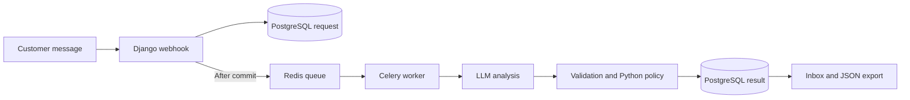

# Architecture

## Flow and state

The webhook saves each message in PostgreSQL and queues a Celery task after the database commit. Redis carries the task. The worker calls the model once per attempt, validates the response, applies routing rules, and saves the result. The browser tester uses this same webhook.

PostgreSQL holds requests, processing attempts, and completed records. Redis only carries work. A caller's idempotency key prevents duplicate submissions. The worker claims an attempt before inference and saves the result and completion together. It does not hold a database transaction open while waiting for the model.

## Model and validation

One `gpt-6.1-terra` request uses [triage_v4](../../prompts/triage_v4.txt) to return category, priority, confidence, core issue, entities, urgency, signals, and a two- or three-sentence summary. One call keeps these related tasks together and limits latency and cost.

A strict JSON schema checks structure. Python checks source excerpts and monetary evidence. These checks catch malformed or unsupported fields; they cannot prove the model understood the message. Confidence is the model's own estimate, not a calibrated probability.

Priority captures operational impact. The urgency field captures explicit urgency such as a deadline; Unknown means none was expressed. The outage signal identifies current broad or multi-user unavailability.

## Routing and escalation

Python owns routing so the rules are visible and testable.

| Category | Standard team | Reason |
| --- | --- | --- |
| Bug Report | Engineering | Investigate broken behavior |
| Feature Request | Product | Assess a new capability |
| Billing Issue | Billing | Investigate charges or payments |
| Technical Question | Technical Support | Answer setup or usage questions |
| Incident/Outage | Engineering | Restore service |

Human Review overrides the team when confidence is below 0.70, an outage is active or unresolved, the analysis is contradictory, information is insufficient, or requests need conflicting destinations. The normal team remains in the record so a reviewer knows who should act next. Priority alone does not cause escalation.

Billing also goes to Human Review when amounts cannot safely be compared or a comparable USD overcharge exceeds $500. Python uses Decimal arithmetic. The invoice example's apparent $260 difference assumes one monthly charge and interprets `$` as USD; the output states both assumptions.

## Failures and access

Transient provider failures receive at most two retries after the initial attempt. SDK retries are disabled so one layer controls retries. Refusals, invalid responses, and permanent failures remain visible errors. Failed queue publication remains visible for operator recovery.

Browser access requires login and CSRF protection. External callers use a bearer token. The application serves one organization; tenant isolation is not implemented. Human Review is a read-only queue.

## Production and Phase 2

For production, I would add reliable database-to-queue publication, worker-crash recovery, queue-age alerts, tenant isolation, and provider billing reconciliation. I would measure queue delay and model latency before increasing worker concurrency, and compare lower-cost models against the same quality checks.

With another week, I would first review summary quality and test crash recovery. Next I would add audited human corrections and queue filters. The current [evaluation](BENCHMARKS.md) uses reused synthetic cases; it does not establish production accuracy.

## Final recovery semantics
Publication uses a separate nullable dispatch_reserved_until reservation, locked
per row and expiring after ten seconds. Scanner publication never advances
next_attempt_at provider eligibility. Due workers claim immediately. Each scan
selects at most 100 rows; publication occurs outside the transaction with a
ten-second countdown. Reservation expiry recovers crashes before publication.
Owner and lease fencing protects completed replacements from stale workers.
Three attempts include interrupted calls. Migration 0003 preserves existing rows.
Recovery requires a running scanner, database and broker. At-least-once provider
execution may incur unsaved costs. Real process-kill, broker-outage and production
acceptance remain unverified.
